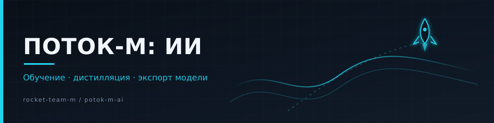
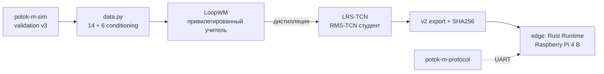

# ИИ-стек «Поток-М»

Модель, обучение, дистилляция и калибровка ассистента стабилизации ракеты. Бортовой инференс вынесен в potok-m-edge. реальные полёты ещё впереди, поэтому все метрики здесь — из воспроизводимых симуляций.

> Статус: инженерный прототип. Симулятор согласован с OpenRocket Simulation 9 в пределах 2% по апогею и vmax; закрытый A/B на 30-секундных сценариях пока показывает, что текущие студенты не обыгрывают zero command. ИИ в полёт не идёт до положительного результата.

## Зачем ассистент

Ракета летит быстро, а активная стабилизация на двигателе запрещена. После выгорания остаётся RPC space: течение и порывы меняют угол атаки быстрее, чем классический контур успевает среагировать. Ассистент на Raspberry Pi смотрит телеметрию 50 Гц, предсказывает боковую перегрузку на 0,2–0,4 с вперёд и отдаёт STM32 ограниченную поправку. Контроллер имеет вето. Три пропуска — и ИИ отключается до конца полёта.



## Модели

### LRS-TCN / RMS-TCN

Бортовая модель. В коде называется `StatefulTCN`: один кадр за тик, состояние живёт между вызовами. RNN-подобное обновление низкоранговое:

$$
W = U V^\top,\quad r=16,\qquad h_{t+1}=0{,}8h_t+0{,}2\,\mathrm{candidate}(x_t,h_t)
$$

RMSNorm вместо LayerNorm, тернарные рекуррентные матрицы с деквантованием при загрузке, fused stem/update. Около 59 тыс. MAC и 78 КБ весов. Никакого 50-кадрового окна на борту — его видит только учитель.

Идея не в том, что TCN «новее трансформера». TCN — это causal convnet с dilation; на коротком окне он дешевле, потому что не делает QKV-проекции на каждом кадре. Классическая ссылка: [Bai, Kolter, Koltun, arXiv:1803.01271](https://arxiv.org/abs/1803.01271).

### LoopWM

Офлайн-учитель. Один parameter-shared блок повторно уточняет латентное состояние; число проходов зависит от нормы обновления, кап 6. Учитель видит истинный ветер и полное состояние, но только в функции потерь — на входе студента их нет. Это линия RMA: [arXiv:2107.04034](https://arxiv.org/abs/2107.04034); сама идея looped world models — [arXiv:2606.18208](https://arxiv.org/abs/2606.18208).

### JEPA, MTP, дистилляция

EMA-учитель с JEPA-головами предсказывает латент на 3/6/10 кадров вперёд по замаскированным кадрам, без реконструкции сырого сигнала. KoLeo мешает схлопнуться. MTP с K=3 даёт плотный сигнал по динамике ветра, но с малым весом, чтобы не выучить шум датчика.

$$
u = u_{\mathrm{base}}(x) + \Delta_\theta(x),\qquad
\mathcal{L}=\mathrm{MSE}(\Delta)+0{,}05\mathcal{L}_{JEPA}+0{,}02\mathcal{L}_{MTP}
$$

### TSCT и оптимизатор

TSCT — наша внутренняя технология без публикации: низкоранговая спектральная параметризация $W=U\,\mathrm{diag}(s)\,V^\top$ с полярной ретракцией Ньютона–Шульца и квантизаторами на факторах. Мы не приписываем ей чужой arXiv-ID.

Тернарные факторы и 4-битные активации идут по линии [BitNet b1.58](https://arxiv.org/abs/2402.17764), [Reloaded](https://arxiv.org/abs/2407.09527), [BitNet v2](https://arxiv.org/abs/2504.18415). Оптимизатор — Muon+, [arXiv:2502.16982](https://arxiv.org/abs/2502.16982).

## Контракт данных

Симулятор пишет `validation.bin` v2/v3 и sidecar:

- 14 физических признаков + 6 conditioning;
- цели `g_roll`, `g_pitch`, confidence, `ai_healthy`;
- v3 добавляет `g_accel_y`, `g_accel_x` — authoritative target для рулей;
- `POTOKTRJ` v2: true x/y/z/velocity/quaternion/omega/mass, ветер, порыв, сдвиг;
- `manifest.json`: config hash, seed, split, сценарии, bounds, sha256.

`g_theta` остаётся angle-domain диагностической целью. Руль потребляет world-frame acceleration; это различие стало причиной отрицательного A/B и сейчас исправляется через v3 target.

## Запуск

```sh
uv sync
uv run ruff check src tests
uv run pytest -q

PYTHONPATH=src uv run python -m potok_ai.engine --help
PYTHONPATH=src uv run python -m potok_ai.engine \
  --model lrs --stage train \
  --data out/final_100/data --out /tmp/potok-run \
  --epochs 100 --seed 1 --device cpu --calibrate

cargo test --manifest-path ai/tui/Cargo.toml
cargo run --release --manifest-path ai/tui/Cargo.toml -- --demo
```

## CI

| Job | Проверка |
|---|---|
| `python` | `uv sync`, ruff, pytest |
| `edge` | fmt, clippy, `cargo test --release --all-targets` с libudev |
| `tui` | fmt, clippy, 6 snapshot-тестов, deterministic SVG |
| `plots` | генерация `rmse_curve.svg`, `ece_curve.svg`, `ab_comparison.svg` |
| `guard` | бинарники и файлы >2 МБ в git не пускаем |

## Отчёты и графики

- `BUILD_LOG.md` — все прогоны, seed, config hash, откаты и причины.
- `out/sweep/` — epoch × seed sweep; 100 эпох выбраны по held-out RMSE.
- `out/final_100/` — финальные exports и calibration.
- `scripts/ab_report.md` — closed-loop A/B: zero command, oracle, студенты.
- `ai/tui` — ratatui-монитор и `--plot-only` SVG для презентаций.

Графики сделаны в стиле opencode.ai: near-black `#0c0c0c`, акцент `#6b8fff`, тонкая сетка, моно-индексы, без эмодзи и SaaS-карточек.

## Ограничения

- Confidence калибруется in-sample на held-out; нужен отдельный re-split.
- 4 held-out сценария — мало для сильного вывода о generalisation.
- На Pi 4 B не мерялся p99; NEON-путь проверен компиляцией.
- Полётного лога нет. Все метрики — симуляционные.
- Текущие студенты проигрывают zero command в closed-loop A/B; oracle выигрывает, значит проблема в training target, не в механике.

Лицензия: GPL-3.0-or-later (или коммерческая).
