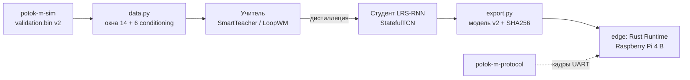

[](https://github.com/rocket-team-m/potok-m-ai/actions/workflows/ci.yml)

# Поток-М: ИИ-стек

Обучение, дистилляция и экспорт модели вспомогательного контура стабилизации ракеты «Поток-М»: от симуляционных окон до бинарного файла для бортового inference.

> Инженерный прототип. Только CPU-прогоны на синтетических данных; замеров на Raspberry Pi 4 B (2 ГБ) и полётного лога нет. Подробности — в разделе «Ограничения».

## Ссылки

- [Формат модели v2](FORMAT.md) — единственное описание байтовой раскладки
- [BUILD_LOG.md](BUILD_LOG.md) — решения, оговорки, результаты прогонов
- [potok-m-sim](https://github.com/rocket-team-m/potok-m-sim) — генератор `validation.bin`
- [potok-m-protocol](https://github.com/rocket-team-m/potok-m-protocol) — канонический UART-протокол
- [Документация проекта](https://rocket-team-m.github.io/potok-m/)

## Архитектура



Учитель — привилегированная модель: один общий `LoopBlock` применяется итеративно (до 6 проходов), две ограниченные поправки и confidence; истинная поправка симулятора (ветер) идёт только в функцию потерь. Представления обучаются через JEPA-головы, предсказывающие латенты EMA-энкодера на 3/6/10 кадров вперёд; KoLeo препятствует схлопыванию. Студент — компактная рекуррентная TCN с тернарными TSCT-слоями, сохраняющая состояние между кадрами и сбрасывающая его в начале эпизода и при смене фазы.

Обучение идёт на остаточной команде `b(x) + Δ` относительно физического baseline из `physics.py`; потеря — нормированный остаток + 0,05 JEPA + 0,02 MTP. Curriculum: `calm → gust → shear → sensor_fault`. Разделение — по сценариям ветра/порывов (16 обучающих, 4 отложенные), а не по типам ракет. Критерий обобщения: `rmse_held_out / rmse_train ≤ 1,25`.

## Быстрый старт

Требуется Python ≥ 3.12 и [uv](https://docs.astral.sh/uv/). Зависимости — CPU-колеса `torch 2.15.0+cpu`.

```bash
uv sync
uv run pytest -q                 # 78 тестов
uv run ruff check src tests

PYTHONPATH=src uv run python -m potok_ai.engine --help
PYTHONPATH=src uv run python -m potok_ai.engine \
  --model loopwm-lite --stage train \
  --data <v2-файл> --out /tmp/potok-lite \
  --epochs 1 --seed 3 --device cpu

PYTHONPATH=src uv run python -m potok_ai.engine \
  --model loopwm-lite --stage eval \
  --data <v2-файл> --out /tmp/potok-lite --device cpu
```

- `--model`: `lrs`, `loopwm-lite`, `loopwm`.
- `--stage`: `train`, `distill`, `eval` (все семейства обучаются от учителя; `eval` только загружает экспорт).
- Результат: таблица метрик в stdout и `metrics.json` в `--out` — `rmse_train`, `rmse_held_out`, `ratio`, `params`, `mac`, `bytes` (плюс `mae`, `max_error`, `ece`, `seed`, `config_hash`).

Бортовой inference живёт в Rust-крэте `edge`: `cargo test && cargo check` внутри каталога. Он читает ту же модель v2 по magic-байтам и сверяет выход с эталонной фикстурой с допуском 1e-6.

## Структура

| Путь | Содержание |
| --- | --- |
| `src/potok_ai/` | `engine.py` (единый CLI), `model.py` (SmartTeacher), `loopwm.py`, `loopwm_lite.py`, `student.py` (LRS-RNN), `export.py`, `data.py`, `optim.py` (Muon+), `jepa.py`, `physics.py`, `curriculum.py`, `calibration.py`, `train*.py` |
| `tests/` | pytest-проверки; `fixtures/tiny_model.bin` и `tiny_expected.npy` — общий с `edge/` эталон |
| `FORMAT.md` | Авторитетное описание формата модели v2 и входного `validation.bin` |
| `BUILD_LOG.md` | Решения, оговорки и результаты CPU-прогонов |
| `benchmark.py` | Замер стадий `train` / `forward` (params, ms/step, frames/s) |

Тяжёлые чекпоинты и датасеты хранятся в Releases, не в git.

## Статус и ограничения

- **Confidence не откалиброван.** На карликовом CPU-прогоне ECE после калибровки 0,42 (raw 0,76) при цели 0,05 — gate не пройден, никаких утверждений о калибровке нет.
- **Замеров на Raspberry Pi 4 B (2 ГБ) нет.** NEON-путь собран под aarch64, но не запускался; все задержки, измеренные на x86-64, — ориентир, не результат для целевой платы. На Cortex-A72 нет ARMv8.2 dot-product, поэтому выигрыш от низкой разрядности нужно мерить на железе.
- **Полётного лога нет.** Обучение — только CPU-прогоны на синтетических/отладочных данных; симулятор ещё должен выпускать `validation.bin` v2 с реальными физическими признаками и флагами сценариев.
- **Аппаратный baseline не перенесён в `edge/`.** Формула `physics.py` должна применяться на борту при развёртывании; эта часть ещё не сделана.

## Лицензия

MIT.
