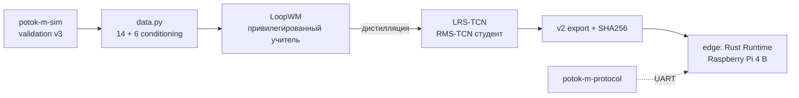

# ИИ-стек «Поток-М»

Модель, обучение, дистилляция и калибровка ассистента стабилизации ракеты. Бортовой инференс вынесен в `potok-m-edge`. Реальные полёты ещё впереди, поэтому все метрики здесь — из воспроизводимых симуляций. Карта модели: `docs/MODEL_CARD.md`.

> Статус: инженерный прототип. Симулятор сверяется с OpenRocket Simulation 9 через гейт ADR-008 (`or_sim9.csv`, эпизод 0, seed 1337, `Config::default()`; лимиты 2 % по апогею и vmax, 0,25 с по времени до апогея, 5 % по высоте и закону сопротивления). Каноническая сверка: апогей 3185,378 м (**1,86 %**), vmax 278,251 м/с (**1,45 %**), время до апогея 27,04 с (**0,14 с**), худшая высота **4,95 %** — регрессионный гейт зелёный; пороги выбраны после измерения, это не доказательство физической точности. Ранний прогон давал 6,40 % / 2,42 % — история, сейчас гейт зелёный. Критерии допуска `SIM_FIDELITY.md` не выполнены, closed-loop A/B после FIXPUMP зелёный (F1, `verdict.status = PASS`, exit 0): oracle-положительный контроль достоверен — латераль снижена на всех 3 сидах (−17,312 / −10,503 / −8,382 м), 12/12 сценарных Δ < 0, привод на пределе; апогей (+11,692 / −2,151 / −7,601 м) — только диагностика. Baseline нулевой команды 1306–1309 м латерали и 1973–1983 м апогея; `loopwm`/`lite` CREDITED 3/3, `lrs` PARTIAL 2/3 (нет seed 3). Пре-FIXPUMP +2 км и старый PASS отозваны; выигрыш скромный (~3 % латерали). Это не лётная квалификация: ИИ остаётся наблюдателем.

## Зачем ассистент

Ракета летит быстро, а активная стабилизация на двигателе запрещена. После выгорания остаётся RPC space: течение и порывы меняют угол атаки быстрее, чем классический контур успевает среагировать. Ассистент на Raspberry Pi смотрит телеметрию 50 Гц, предсказывает боковую перегрузку на 0,2–0,4 с вперёд и отдаёт STM32 ограниченную поправку. Контроллер имеет вето. Watchguard — чистая детерминированная функция-фильтр: она отклоняет нефинитные, внедиапазонные, низкоуверенные и слишком резкие команды, а три пропуска подряд защёлкивают отключение ИИ до конца полёта (сброс — только явным `reset()`).



## Безопасность и watchguard

- Команда руля — `[g_accel_y, −g_accel_x]` (м/с², мировая система), ограничена `g_max·tanh` и проходит через watchguard прежде чем дойти до STM32.
- Причины отказа перечислены в фиксированном порядке: `latched → non_finite → out_of_bounds → low_confidence → rate_limit`. Любое отклонение даёт нулевую команду и не сдвигает опорное значение для проверки скорости.
- Три подряд пропуска защёлкивают `LATCHED`; следующий корректный кадр защёлку не снимает. Независимое вето на уровне dispatch: `ai_healthy = 0` или невалидные датчики обнуляют команду даже при `OK` от guard.
- Реализации: чистая функция `potok_ai.watchguard` и зеркало в edge/firmware. Прошивочный SIL-гейт (ADR-009) прогоняет отказы провода, защёлку и бюджет 50 мкс на детерминированном 500 Гц харнессе.

## Модели

### LRS-TCN / RMS-TCN

Бортовая модель. В коде называется `StatefulTCN`: один кадр за тик, состояние живёт между вызовами. RNN-подобное обновление низкоранговое:

$$
W = U V^\top,\quad r=16,\qquad h_{t+1}=0{,}8h_t+0{,}2\,\mathrm{candidate}(x_t,h_t)
$$

RMSNorm вместо LayerNorm, тернарные рекуррентные матрицы с деквантованием при загрузке, fused stem/update. Около 59 тыс. MAC и 78 КБ весов. Никакого 50-кадрового окна на борту — его видит только учитель.

Идея не в том, что TCN «новее трансформера». TCN — это causal convnet с dilation; на коротком окне он дешевле, потому что не делает QKV-проекции на каждом кадре. Классическая ссылка: [Bai, Kolter, Koltun, arXiv:1803.01271](https://arxiv.org/abs/1803.01271).

### LoopWM

Офлайн-учитель. Один parameter-shared блок повторно уточняет латентное состояние; число проходов зависит от нормы обновления, кап 6. Учитель видит истинный ветер и полное состояние, но только в функции потерь — на входе студента их нет. Это линия RMA: [arXiv:2107.04034](https://arxiv.org/abs/2107.04034); сама идея looped world models — [arXiv:2606.18208](https://arxiv.org/abs/2606.18208).

### JEPA, MTP, дистилляция

EMA-учитель с JEPA-головами предсказывает латент на 3/6/10 кадров вперёд по замаскированным кадрам, без реконструкции сырого сигнала. KoLeo мешает схлопнуться. MTP с K=3 даёт плотный сигнал по динамике ветра, но с малым весом, чтобы не выучить шум датчика.

$$
u = u_{\mathrm{base}}(x) + \Delta_\theta(x),\qquad
\mathcal{L}=\mathrm{MSE}(\Delta)+0{,}05\mathcal{L}_{JEPA}+0{,}02\mathcal{L}_{MTP}
$$

### TSCT и оптимизатор

TSCT — наша внутренняя технология без публикации: низкоранговая спектральная параметризация $W=U\,\mathrm{diag}(s)\,V^\top$ с полярной ретракцией Ньютона–Шульца и квантизаторами на факторах. Мы не приписываем ей чужой arXiv-ID.

Тернарные факторы и 4-битные активации идут по линии [BitNet b1.58](https://arxiv.org/abs/2402.17764), [Reloaded](https://arxiv.org/abs/2407.09527), [BitNet v2](https://arxiv.org/abs/2504.18415). Оптимизатор — Muon+, [arXiv:2502.16982](https://arxiv.org/abs/2502.16982).

## Контракт данных

Симулятор пишет `validation.bin` v2/v3 и sidecar:

- 14 физических признаков + 6 conditioning;
- цели `g_roll`, `g_pitch`, confidence, `ai_healthy`;
- v3 добавляет `g_accel_y`, `g_accel_x` — authoritative target для рулей;
- `POTOKTRJ` v2/v3: true x/y/z/velocity/quaternion/omega/mass, ветер, порыв, сдвиг; v3 добавляет `g_accel_y`/`g_accel_x`;
- `manifest.json`: config hash, seed, split, сценарии, bounds, sha256.

Авторитетная цель обучения и руля — `[g_accel_y, −g_accel_x]` (м/с², мировая система, ±10 м/с²); `g_theta` (`g_roll`, `g_pitch`, ±0,12 рад) остаётся angle-domain диагностикой и в команду не повышается. Файл v1/v2 без колонок `g_accel` отклоняется громко, подмены угловой целью нет. Именно подмена угла ускорением стала причиной отрицательного A/B; прогон v3 target (`out/v3_final`) исправляет контракт, и closed-loop A/B для него после FIXPUMP пройден по F1; цифры v2 и v3 не сравнимы.

## Запуск

```sh
uv sync
uv run ruff check src tests
uv run pytest -q

PYTHONPATH=src uv run python -m potok_ai.engine --help
PYTHONPATH=src uv run python -m potok_ai.engine \
  --model lrs --stage train \
  --data out/final_100/data --out /tmp/potok-run \
  --epochs 100 --seed 1 --device cpu --calibrate

cargo test --manifest-path ai/tui/Cargo.toml
cargo run --release --manifest-path ai/tui/Cargo.toml -- --demo
```

## CI

| Job | Проверка |
|---|---|
| `python` | `uv sync`, ruff, pytest |
| `edge` | fmt, clippy, `cargo test --release --all-targets` с libudev |
| `tui` | fmt, clippy, 6 snapshot-тестов, deterministic SVG |
| `plots` | генерация `rmse_curve.svg`, `ece_curve.svg`, `ab_comparison.svg` |
| `guard` | бинарники и файлы >2 МБ в git не пускаем, GPL-лицензия, локальные markdown-ссылки |

### Ночные гейты

Помимо CI, контракты закреплены ночным проходом 23.11.2026 (`VERIFY-*` и hard-gate тесты): Python `ruff`/`pytest` зелёные; `cargo test --workspace`, `fmt` и `clippy -D warnings` зелёные в симуляторе и протоколе. Добавлены жёсткие гейты v3 export/load round-trip, watchguard → dispatch (защёлка, нефинитные значения, вето `ai_healthy`), дистилляции учитель→студент и инвариантности аугментации (held-out побитно не меняется, детерминированный seed по окну, флаги, отсутствие NaN). Зелёные гейты фиксируют интерфейсы, но не делают модель пригодной к полёту: parity-гейт — зелёный регрессионный пин (не доказательство точности), closed-loop A/B после FIXPUMP зелёный (F1, PASS, exit 0; oracle-контроль достоверен, `lrs` PARTIAL 2/3), а противоречие ТТХ M=0,5–0,6 против OR M=0,82 открыто.

## Отчёты и графики

- `BUILD_LOG.md` — все прогоны, seed, config hash, откаты и причины.
- `out/sweep/` — epoch × seed sweep; 100 эпох выбраны по held-out RMSE.
- `out/final_100/` — финальные exports и calibration.
- `ab_report.md` — closed-loop A/B: zero command, oracle, студенты (post-FIXPUMP, F1, verdict PASS; пре-FIXPUMP +2 км и старый PASS отозваны).
- `ai/tui` — ratatui-монитор и `--plot-only` SVG для презентаций.

Графики выдержаны в едином стиле: near-black `#0c0c0c`, акцент `#6b8fff`, тонкая сетка, моно-индексы, без эмодзи и SaaS-карточек.

## Ограничения

- Confidence калибруется in-sample на held-out; нужен отдельный re-split.
- 4 held-out сценария — мало для сильного вывода о generalisation.
- На Pi 4 B не мерялся p99; NEON-путь проверен компиляцией.
- Полётного лога нет. Все метрики — симуляционные.
- Closed-loop A/B v3 на текущей физике **пройден по F1** (`verdict.status = PASS`, exit 0): oracle — положительный контроль — достоверен: латераль снижена на всех 3 сидах (−17,312 / −10,503 / −8,382 м), все 12 сценарных Δ < 0, привод на пределе (16 661 / 16 584 / 16 531 тик); апогей +11,692 / −2,151 / −7,601 м — только диагностика. `loopwm` и `lite` CREDITED 3/3 (seed 1 `loopwm`: −42,042 м латерали / +104,041 м апогея), `lrs` PARTIAL 2/3 (seeds 1/2: −152,15 / −141,00 м и +330,94 / +296,72 м; для seed 3 экспорта нет, подстановок нет). PASS — о боковом управлении со скромным выигрышем (~42 м из ~1309 м, ≈3 % латерали), не о лётной квалификации. Жёсткие границы: фазовый пол ≈175 м, кинематическая ≈640 м (−51 %, физически недостижима), энергетический потолок ≈3903–3925 м — это bounds, а не цели. Пре-FIXPUMP +2 км (апогей ~3971 м), бары 1528/1735 м, исторические −26,19 / +125,12 м и oracle +2236 м, а также старый вердикт PASS отозваны после FIXPUMP: тогда нормальная сила качала энергию.
- Старый выигрыш oracle после исправления физического отображения привода (491–515 м pooled lateral RMS, 4 held-out эпизода × 3 seed) проверял стык симулятора, а не студента; после FIXPUMP его апогейный авторитет исчез.

Лицензия: собственный код — `GPL-3.0-or-later` (ADR-005, `LICENSE`); проприетарное использование оформляется отдельным договором (`LICENSE-COMMERCIAL.md`). Сторонние компоненты сохраняют свои лицензии; внутреннее использование без распространения GPL не обязывает открывать код.
