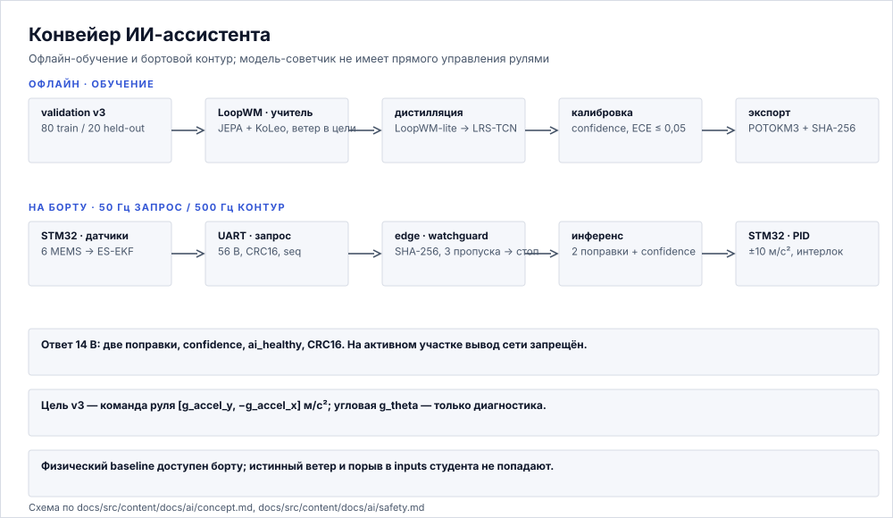

Полная версия — [«ИИ-ассистент системы стабилизации „Поток-М“: концепт»](../../pdf/potok-m-ai-concept.pdf).

## Кто управляет

STM32H743 собирает датчики на 500 Гц, фильтрует их, считает ПИД, крутит сервы
и держит интерлоки. Raspberry Pi 4 B (2 ГБ) получает окно телеметрии по UART на
50 Гц и советует две поправки к уставкам. Прямого управления рулями у сети нет:
контроллер применяет ограниченную поправку или отклоняет её. На активном
участке вывод сети запрещён — ни код, ни нейросеть не стабилизируют полёт при
работающем двигателе.

Архитектура моделей — в [моделях](/potok-m/docs/ai/models/), фильтрация команд — в
[безопасности](/potok-m/docs/ai/safety/).

*Рисунок: офлайн-обучение и бортовой контур. Сеть выдаёт две поправки с
confidence; контроллер применяет их только при открытом интерлоке.*

## Что предсказывает сеть

По окну 0,5 с предсказывается боковая перегрузка через 0,2–0,4 с. ПИД видит
ошибку, когда она уже есть; ассистент даёт команду заранее. На выходе — две
поправки, confidence и флаг исправности. Коррекции ограничены `g_max·tanh`,
авторитетная цель v3 — команда руля `[g_accel_y, −g_accel_x]` (м/с², мировая
система), предел ±10 м/с². Угловая цель `g_theta` (`g_roll`, `g_pitch`, ±0,12 rad)
остаётся только диагностикой; файл v1/v2 без колонок `g_accel` отвергается
громко, подмены угловой целью нет.

## Фильтрация датчиков

Шесть MEMS дают один вектор методом наименьших квадратов; разброс падает
примерно в √6 раза. Дальше — ES-EKF на 500 Гц; шумы Q и R берутся из вариации
Аллана, а не из даташита.

Акселерометр меряет удельную силу в **своих осях**, которые поворачиваются
вместе с корпусом: `f_b = R(q)ᵀ(a_w − g_w) + b_a + v`. Наклон переливает
проекцию гравитации из одной оси в другую, поэтому направление можно читать
как горизонт только при малом линейном ускорении. Модуль от поворота не
зависит: `‖f_b‖ ≈ 9,81 м/с²` — необходимое условие. На 170–200 м/с торможение
даёт ≈0,45–0,6 g, модуль уходит к 1,1–1,16 g, и слепое доверие ломает оценку
наклона примерно на 30°. Поэтому гейт по фазе обязателен, а порог по модулю —
только дополнительная проверка.

## Связь с контроллером

Кадр запроса: magic, seq, время, фаза, гиро, аксель, магнитометр, высота,
Pitot, флаги, CRC16 — 56 байт в полном профиле и 42 байта в облегчённом.
Ответ: две поправки, confidence, `ai_healthy`, CRC16 — 14 и 16 байт
соответственно. Бюджет полного цикла <10 мс p99 при частоте 50 Гц. Три
пропуска подряд или `ai_healthy = 0` отключают ассистента до явного сброса.
Фазу выставляет контроллер. Описание кадра хранится отдельным файлом;
генератор делает из него C-структуры и Python-парсер, чтобы прошивка,
симулятор и разбор логов читали одно и то же.

## Безопасность

Спасение, разделение ступеней и таймеры остаются на классической логике.
Модель заморожена, дообучения в полёте нет. Зависшие датчики отбрасываются до
входа в сеть. Всё пишется в журнал. Если Pi не загрузился к старту — полёт без
ИИ, это нормально. Независимые интерлоки и watchdog-политика подключены в
рабочий цикл прошивки; SIL проверяет их на хосте, но замена реальной плате —
нет.

## Обучение и проверка

Симулятор 6-DoF с турбулентностью Драйдена и отдельными порывами, сенсорный
тракт моделируется отдельно. Масса, центровка, тяга и ветер рандомизируются в
пределах допусков. Цепочка: предобучение → дистилляция от эталона → при
необходимости RL. Проверка: симулятор, стенд, не менее двух пусков. Реальный
полёт пока отсутствует; подробности — в
[гейтах и статусе A/B](/potok-m/docs/ai/gates/).

## Где живёт код

Модель и обучение — [potok-m-ai](https://github.com/rocket-team-m/potok-m-ai),
симулятор и генерация v3 — [potok-m-sim](https://github.com/rocket-team-m/potok-m-sim),
кадр — [potok-m-protocol](https://github.com/rocket-team-m/potok-m-protocol),
прошивка — [potok-m-firmware](https://github.com/rocket-team-m/potok-m-firmware),
инференс — [potok-m-edge](https://github.com/rocket-team-m/potok-m-edge).
Аэрокарточку поставляет RocketCraft. Карта репозиториев — в
[архитектуре](/potok-m/docs/project/architecture/); собственный код —
`GPL-3.0-or-later`.
