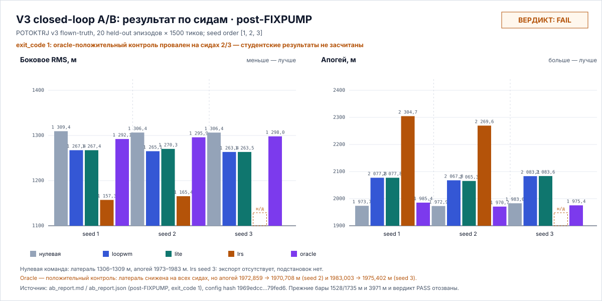

## Ночные hard-gate тесты

Девять жёстких тестовых файлов фиксируют интерфейсы, а не качество модели:

| Контракт | Тестов |
| --- | --- |
| v3 export → load round-trip, SHA и отказ v1/v2 | 10 |
| watchguard → dispatch (защёлка, нефинитные значения, вето) | 7 |
| Отчёт калибровки и conformal | 7 + 21 |
| Быстрая модель: точный MAC и детерминированный p50/p99 | 3 |
| Дистилляция учитель → студент | 2 |
| Инвариантность аугментации | 12 |
| Движок: 100 эпох, два прогона с одним seed | 1 |
| Схема отчёта A/B и exit-code контракт | 7 |

Итого 70 гейтов. Полный прогон `pytest -q` в отдельном репозитории
`potok-m-ai` — 88 тестов; в канонической копии с ночными файлами количество
зависит от состава дерева. Остальные `VERIFY-*`-прогоны 23.11.2026 зелёные:
sim — 67 тестов в отдельном репозитории и 154 в монорепозитории, protocol —
36, firmware — 216, workbench — все workspace-таргеты.

## Closed-loop A/B: v6 FAIL текущий, v5/v4 FAIL и F1 PASS — история

### v6 (night_final, обе руки) — FAIL, текущий вердикт

`scripts/ab_v6.py` на двух руках из `ai/out/night_final`: `night_default` —
четырёхстадийный дефолт `sft → privileged → dagger → distill`
(`exports/teacher_v2_s{1,2,3}.pt`), `night_adversarial` — опциональный
`--adversarial`-переобученный студент (`adversarial/runs/s{1,2,3}/student.pt`,
те же 3 seed / 100 эпох, без изменений гейтов или порогов). Обе руки —
студенты одного teacher-v2 дефолта, residual policy включена, предел
±10 м/с²; каждая сравнивается только со спаренной нулевой командой, сравнения
рука против руки нет. Замороженный post-FIXPUMP held-out, 20 эпизодов на seed,
те же неослабленные гейты AIPOST1/EVAL01. Deployment-proxy — первый тик
`DESCENT` (`vz<0 ∧ z≥5`), радиальное расстояние от площадки, pooled RMS;
апогей — максимум z за 30 с.

| Seed | zero command: dep / апогей / lat, м | night_default: dep / апогей / lat, м | night_adversarial: dep / апогей / lat, м |
| --- | --- | --- | --- |
| 1 | 1690,76 / 1973,74 / 1309,41 | **1462,98 / 2366,25 / 1118,55** | 1458,08 / 2347,99 / 1132,33 |
| 2 | 1688,42 / 1972,86 / 1306,40 | **1560,57 / 2213,94 / 1182,50** | 1553,58 / 2252,12 / 1179,59 |
| 3 | 1689,19 / 1983,00 / 1306,38 | **1454,26 / 2327,48 / 1129,39** | 1456,54 / 2308,26 / 1142,84 |

Прирост к спаренной нулевой команде (полная траектория): латераль
`night_default` **−14,58 / −9,48 / −13,55 %**, `night_adversarial`
**−13,52 / −9,71 / −12,52 %**; апогей **+19,89 / +12,22 / +17,37 %** и
**+18,96 / +14,16 / +16,40 %** соответственно. Обе руки проходят апогей
≥2000 м на всех сидах и не достигают 1000 м deployment-латерали.

Вердикт: `FAIL`, `exit_code = 1`, `win_claimed = false` для каждой руки и для
прогона в целом — победа требует прохода всех гейтов каждой руки.

- **`night_default` — FAIL, 4 PASS / 7 FAIL.** PASS (гейты EVAL01 дословно):
  `rmse_ratio`, `ece_source`, `ece`, `provenance`. FAIL: `seed_spread`
  (прирост латерали 12,54 % не бьёт 3× разброс 5,09 %, апогея 16,49 % — 3×
  разброс 7,67 %); `closed_loop_improvement` (−35 % / +15 % не достигнуты,
  seed 2 апогея +12,22 %); `oracle_positive_control` (апогей oracle падает на
  seed 2/3: −2,15 / −7,60 м, seed 1 +11,69 м); три `seed N absolute gates`
  (деплой-латераль 1462,98 / 1560,57 / 1454,26 м > 1000 м при апогее 2366,25 /
  2213,94 / 2327,48 м ≥ 2000 м); `oracle_deployment_and_apogee_positive_control`
  (латераль oracle падает на всех сидах −40,48 / −37,79 / −35,99 м, но апогей
  +11,69 / −2,15 / −7,60 м; cap fraction 1,0, 16 661 / 16 584 / 16 531 тик).
- **`night_adversarial` — FAIL, 5 PASS / 6 FAIL.** PASS: те же четыре плюс
  `seed_spread` (приросты бьют 3× разброс). FAIL: `closed_loop_improvement`
  (−13,52 / −9,71 / −12,52 % латерали, seed 2 апогея +14,16 %);
  `oracle_positive_control`; три `seed N absolute gates` (деплой-латераль
  1458,08 / 1553,58 / 1456,54 м > 1000 м, апогей 2347,99 / 2252,12 / 2308,26 м
  ≥ 2000 м); `oracle_deployment_and_apogee_positive_control`.

Никакой победы не заявлено: обе руки промахиваются мимо −35 % / +15 % и 1000 м
с большим запасом, а положительный контроль самого инструмента не проходит
апогейную половину на двух сидах из трёх. Adversarial ближе по одному гейту
(`seed_spread` проходит) и имеет лучший апогей seed 2, но FAIL — измеренное
попадание не в цель, а не ослабление гейта. Измерение симуляционное: POTOKTRJ
выходит из того же симулятора; посадочного события нет, proxy — тик снижения,
а не разброс приземления.

:::danger
**Текущий вердикт — v6 (night_final), FAIL обе руки.** `exit_code = 1`,
`win_claimed = false`: `night_default` — 4 PASS / 7 FAIL, `night_adversarial` —
5 PASS / 6 FAIL (`scripts/ab_report_v6.json`, `scripts/ab_report_v6.md`,
`.bulba/night/ABV6.md`). Апогей ≥2000 м проходит на всех сидах обеих рук;
деплой-латераль 1462,98–1560,57 м (default) и 1458,08–1553,58 м (adversarial)
> 1000 м; oracle-апогей +11,69 / −2,15 / −7,60 м. v5 (FINAL all-fix), v4
(AIPOST1) и F1 — история. Победы не заявлено.
:::

### v5 (FINAL all-fix) — FAIL, история

`scripts/ab_v5.py` на FINAL all-fix distill-экспортах `ai/out/final_v3_allfix/exports/teacher_v2_s{1,2,3}.pt` (четырёхстадийный дефолт `sft → privileged → dagger → distill`), замороженный post-FIXPUMP held-out, 20 эпизодов на seed, те же неослабленные гейты AIPOST1. Deployment-proxy — первый тик `DESCENT` (`vz<0 ∧ z≥5`), радиальное расстояние от стартовой площадки, pooled RMS; апогей — максимум z за 30 с.

| Seed | zero: dep / апогей / lat, м | teacher_v2 (allfix): dep / апогей / lat, м |
| --- | --- | --- |
| 1 | 1690,76 / 1973,74 / 1309,41 | **1473,06 / 2334,55 / 1138,45** |
| 2 | 1688,42 / 1972,86 / 1306,40 | **1558,44 / 2251,14 / 1179,44** |
| 3 | 1689,19 / 1983,00 / 1306,38 | **1496,79 / 2305,87 / 1145,63** |

Прирост к спаренной нулевой команде (полная траектория): латераль **−13,06 / −9,72 / −12,31 %**, апогей **+18,28 / +14,11 / +16,28 %**. Deployment-латераль −12,88 / −7,70 / −11,39 %.

Вердикт: `FAIL`, `exit_code = 1`, **5 PASS / 6 FAIL**:

- PASS (гейты EVAL01 дословно): `rmse_ratio`, `ece_source`, `ece`, `provenance` и — впервые относительно v4 — `seed_spread` (приросты теперь бьют 3× разброс трёх seed).
- FAIL `seed 1/2/3 absolute gates`: deployment-латераль 1473,06 / 1558,44 / 1496,79 м > лимита 1000 м на всех сидах; апогей 2334,55 / 2251,14 / 2305,87 м ≥ 2000 м проходит на всех трёх сидах.
- FAIL `closed_loop_improvement`: −35 % / +15 % не достигнуты (латераль −13,06 / −9,72 / −12,31 %, апогей +18,28 / +14,11 / +16,28 %, где seed 2 ниже +15 %).
- FAIL `oracle_positive_control`: апогей oracle падает на seed 2/3 (−2,15 / −7,60 м; seed 1 +11,69 м).
- FAIL `oracle_deployment_and_apogee_positive_control`: латераль oracle падает на всех сидах (−40,48 / −37,79 / −35,99 м), но апогей — +11,69 / −2,15 / −7,60 м; привод задействован полностью (cap fraction 1,0; 16 661 / 16 584 / 16 531 тик).

Никакой победы не заявлено: гейт закрытия не проходит по шести причинам, и положительный контроль не может сертифицировать улучшение апогея. All-fix экспорт заметно ближе к цели, чем рука v4 (латераль ~10–13 % против ~0,4–5,6 %, апогей ≥2000 м на всех сидах, `seed_spread` теперь проходит), но FAIL — измеренное попадание не в цель, а не ослабление гейта. Измерение симуляционное: POTOKTRJ выходит из того же симулятора; посадочного события нет, proxy — тик снижения, а не разброс приземления.

:::danger
**v5 (FINAL all-fix) — FAIL, история.** Неослабленные пред-регистрированные гейты AIPOST1: `exit_code = 1`, **5 PASS / 6 FAIL** (`scripts/ab_report_v5.json`, `scripts/ab_report_v5.md`). PASS: `rmse_ratio`, `ece_source`, `ece`, `provenance`, `seed_spread`. FAIL: deployment-латераль 1473,06 / 1558,44 / 1496,79 м > 1000 м на всех сидах; −35 % / +15 % не достигнуты; oracle-положительный контроль недостоверен по апогею на seed 2/3. Апогей ≥2000 м проходит на всех сидах. Победы не заявлено. Вытеснен v6 как текущий вердикт.
:::

### v4 (AIPOST1) — FAIL, история

`scripts/ab_v4.py` на четырёхстадийных экспортах `sft → privileged → dagger →
distill` (`teacher_v2_s{1,2,3}.pt`), 20 held-out эпизодов на seed, те же гейты без
ослаблений. Deployment-proxy — первый тик `DESCENT` (`vz<0 ∧ z≥5`), радиальное
расстояние от стартовой площадки, pooled RMS; апогей — максимум z за 30 с.

| Seed | zero: dep / апогей / lat, м | teacher_v2: dep / апогей / lat, м |
| --- | --- | --- |
| 1 | 1690,76 / 1973,74 / 1309,41 | **1611,99 / 2137,89 / 1236,59** |
| 2 | 1688,42 / 1972,86 / 1306,40 | 1632,11 / 1974,90 / 1294,59 |
| 3 | 1689,19 / 1983,00 / 1306,38 | 1642,11 / 1965,68 / 1301,23 |

Вердикт: `FAIL`, `exit_code = 1`, **4 PASS / 7 FAIL**:

- PASS (гейты EVAL01 дословно): `rmse_ratio`, `ece_source`, `ece`, `provenance`.
- FAIL `seed 1/2/3 absolute gates`: deployment-латераль 1611,99 / 1632,11 /
  1642,11 м > лимита 1000 м на всех сидах; апогей 2137,89 м проходит на seed 1,
  но 1974,90 / 1965,68 м < 2000 м на seed 2/3.
- FAIL `seed_spread`: прирост латерали 2,37 % не бьёт 3× разброс seed 5,18 %,
  прирост апогея 2,52 % — 3× разброс 9,19 %.
- FAIL `closed_loop_improvement`: ни −35 % латерали, ни +15 % апогея не
  достигнуты (seed 1: −5,56 % / +8,32 %; seed 2: −0,90 % / +0,10 %; seed 3:
  −0,39 % / −0,87 %).
- FAIL `oracle_positive_control`: апогей oracle падает на seed 2/3 (−2,15 /
  −7,60 м; seed 1 +11,69 м).
- FAIL `oracle_deployment_and_apogee_positive_control`: латераль oracle падает на
  всех сидах (−40,48 / −37,79 / −35,99 м), но апогей — +11,69 / −2,15 / −7,60 м;
  привод задействован полностью (cap fraction 1,0; 16 661 / 16 584 / 16 531 тик),
  так что контроль не инертен, но не достоверен для апогея.

Никакой победы не заявлено: положительный контроль не может сертифицировать
улучшение апогея. Измерение симуляционное: POTOKTRJ выходит из того же
симулятора; посадочного события нет, proxy — тик снижения, а не разброс
приземления.

:::danger
**v4 (AIPOST1) — FAIL, история.** Неослабленные пред-регистрированные
гейты: `exit_code = 1`, **4 PASS / 7 FAIL** (`scripts/ab_report_v4.json`,
`scripts/ab_report_v4.md`). PASS: `rmse_ratio`, `ece_source`, `ece`,
`provenance`. FAIL: боковая RMS > 1000 м на всех сидах, апогей < 2000 м на
seed 2/3, пороги −35 % / +15 % не достигнуты, oracle-положительный контроль
недостоверен. Победы не заявлено. Вытеснен v5, затем v6 как текущим вердиктом.
:::

:::note
**F1 (ABFIX/ORCLR, 23.11.2026) — PASS в узком детекторе.** Проверялись только
латераль, знак 12 сценарных Δ и использование привода; апогей был понижен до
диагностики. `verdict.status = PASS`, `exit_code = 0`. Проход не отменяется,
но и не является текущим вердиктом: полный набор гейтов даёт FAIL в v6 (и
ранее в v5/v4). Ни один из детекторов не является лётной квалификацией: реальных
пусков нет, ИИ остаётся наблюдателем.
:::

### Исторический проход F1 (узкий детектор) — PASS

*Рисунок: историческое сравнение двух детекторных линий (v4 FAIL / F1 PASS);
гистограммы по сидам — данные исторического F1-прохода (сценарии 16–19,
`loopwm`/`lite`/`lrs`/oracle), где «н/д» у `lrs` на seed 3 означает отсутствие
экспорта без подстановок. Текущий вердикт — v6 в таблице выше; авторитетны
`scripts/ab_report_v6.md/json` (v6), `scripts/ab_report_v5.md/json` (v5),
`scripts/ab_report_v4.md/json` (v4) и `ab_report.md/json` (F1).*

Измерение — по flown-truth sidecar `POTOKTRJ` v3 (stride 26), а не по
суррогату. Двадцать удержанных эпизодов сценариев 16–19, 1500 тиков на
эпизод (30 с), seed order [1, 2, 3], config hash
`1969edcc0829536c4b2ee1bff0ba7d663a22fa36dec588fac67c96107379fed6`.
Базис — нулевая команда; студент — `physics_baseline + Delta` из замороженного
v3-экспорта, только при `ai_healthy` и калибровочном пороге, с hard-огранчением
±10 м/с². Ни один порог, coefficient или сценарий под результат не подгонялся.

Post-FIXPUMP (`584b1dc`: нормальная аэродинамическая сила не совершает
положительную работу; `7ddf324`: drag привязан к массе траектории). Baseline
нулевой команды: 1306,4–1309,4 м латерали и 1972,9–1983,0 м апогея.

| Рука | Seed | Боковое RMS, м (Δ) | Апогей, м (Δ) |
| --- | --- | --- | --- |
| zero command | 1 | 1309,409 | 1973,743 |
| zero command | 2 | 1306,397 | 1972,859 |
| zero command | 3 | 1306,380 | 1983,003 |
| oracle | 1 | 1292,097 (−17,3) | 1985,435 (+11,7) |
| oracle | 2 | 1295,894 (−10,5) | 1970,708 (−2,2) |
| oracle | 3 | 1297,999 (−8,4) | 1975,402 (−7,6) |
| `loopwm` | 1 | 1267,367 (−42,0; 96,79 %) | 2077,784 (+104,0) |
| `loopwm` | 2 | 1265,149 (−41,2) | 2067,786 (+94,9) |
| `loopwm` | 3 | 1263,437 (−42,9) | 2083,105 (+100,1) |
| `lite` | 1 | 1267,370 (−42,0) | 2077,789 (+104,0) |
| `lrs` | 1 | 1157,264 (−152,1; 88,38 %) | 2304,678 (+330,9) |
| `lrs` | 2 | 1165,393 (−141,0) | 2269,575 (+296,7) |
| `lrs` | 3 | н/д | н/д |

В историческом F1-проходе положительный контроль oracle достоверен
(`verdict.status = PASS`, `exit_code = 0`): латераль снижена на всех трёх сидах (−17,312 / −10,503 /
−8,382 м), все 12 сценарных Δ латерали отрицательны, привод задействован на
пределе (16 661 / 16 584 / 16 531 активный тик из столько же, пик команды
10,0 м/с²). Апогей (+11,692 / −2,151 / −7,601 м) — **только диагностика**, не
критерий прохода. `loopwm` и `lite` — CREDITED 3/3 (`lite` на seed 2 даёт
−36,13 / +92,45 м, на seed 3 −42,91 / +100,58 м), `lrs` — PARTIAL 2/3: seed 3
не измерен из-за отсутствия экспорта `ai/out/v3_final/runs/lrs/s3/lrs.bin`,
подстановок не делалось. PASS — о боковом управлении; выигрыш скромный:
~42 м из ~1309 м латерали (≈3 %).

Этот PASS относится **только** к узкому детектору F1 (латераль + знак +
привод, апогей — диагностика) и вытеснен как текущий вердикт измерением v6:
FAIL (night_default 4 PASS / 7 FAIL, night_adversarial 5 PASS / 6 FAIL); ранее
v5: FAIL, 5 PASS / 6 FAIL, и v4: FAIL, 4 PASS / 7 FAIL. Все проходы —
симуляция, не лётная квалификация.

Жёсткие границы после исправления (не predictions; `RECALC01.md`): фазовый
гейт замораживает первые 498 тиков — пол RMS ≈174–175 м, ниже контроллер
опуститься не может; кинематическая граница ≈640 м (−51 %) предполагает
бесконечное боковое ускорение и физически недостижима; потолок по энергии на
выгорании ≈3903–3925 м даёт верхнюю границу прироста апогея
≈+1930…+1949 м и тоже очень слабый. Реализованные guidance-выигрыши —
≈1–11 % латерали и ≈0–17 % апогея; даже лучший `lrs` — примерно четверть
жёсткой латеральной границы и около 1/12 апогейной.

Исторический контекст, **отозванный**: до FIXPUMP та же физика давала baseline
1528,366 / 1734,977 м, `loopwm` −26,19 м латерали и +125,12 м апогея, а oracle
−493,14 / +2236,22 м (апогей ~3971 м). Из этих чисел выводили «потолки»
35–40 % латерали (RMS 920–990 м) и +2400…+2700 м апогея. Источник был не
управление, а энергетический насос: нормальная сила была параллельна
боковому относительному ветру и совершала положительную работу. После
исправления эти числа и потолки недействительны и сохранены только как
история, не как контрольная точка; старый вердикт PASS и пре-FIXPUMP +2 км
апогея (≈3971 м) отозваны вместе с ними.

Исторический v1/v2-прогон с угловой целью (`ab_report.json` на `e57c6bf`,
`exit_code = 1`) перекрыт текущим артефактом: его числа получены на цели,
которую привод не может потребить, и не являются контрольной точкой v3.

## Parity как регрессионный пин

Каноническая сверка — OpenRocket Simulation 9, фикстура `or_sim9.csv`
(55 строк), эпизод 0, seed 1337, `Config::default()`:

| Метрика | OR | Симулятор | Ошибка | Лимит |
| --- | ---: | ---: | ---: | ---: |
| Апогей | 3127,363 м | 3185,378 м | 1,86 % | 2 % |
| Vmax | 274,278 м/с | 278,251 м/с | 1,45 % | 2 % |
| Время до апогея | 26,9 с | 27,04 с (тик 1352) | 0,14 с | 0,25 с |
| Высота, худшая точка | — | t = 5 с | 4,95 % | 5 % |

Закон лобового сопротивления воспроизводит OR с ошибкой 1–2,3 % при лимите
5 %. Пороги выбраны после измерения: это регрессионные пины текущей модели,
а не доказательство физической точности. Мгновенная скорость не
сравнивается: в `Frame` нет поля скорости, а `pitot_dp` — шумное насыщаемое
`i16`. Противоречие M=0,5–0,6 по ТТХ против M=0,82 у OR остаётся открытым.

## Что мешает допуску к реальному управлению

1. Нет ни одного реального лётного лога.
2. Статистики датчиков не подтверждены стендовыми измерениями Аллана.
3. Текущий v6 A/B (night_final, обе руки) **провален** (FAIL, exit 1,
   `win_claimed = false`): `night_default` 4 PASS / 7 FAIL,
   `night_adversarial` 5 PASS / 6 FAIL; деплой-латераль 1454–1561 м > 1000 м,
   −35 % / +15 % и oracle-контроль не проходят; апогей ≥2000 м проходит на
   всех сидах. v5 (FINAL all-fix, FAIL, 5 PASS / 6 FAIL), v4 (AIPOST1, FAIL,
   4 PASS / 7 FAIL) и исторический F1 PASS (exit 0, латераль+знак) остаются
   историей. Все — симуляция, не реальный полёт и не лётная квалификация.
4. Симулятор не прошел критерии допуска `SIM_FIDELITY.md` в части реального
   лётного лога и сравнения выхода модели на настоящих кадрах.

Источник: `scripts/ab_report_v6.json`, `scripts/ab_report_v6.md`,
`.bulba/night/ABV6.md` (v6 FAIL, текущий); `scripts/ab_report_v5.json`,
`scripts/ab_report_v5.md`, `.bulba/night/ABV5.md` (v5 FAIL, история); `scripts/ab_report_v4.json`,
`scripts/ab_report_v4.md`, `.bulba/night/AIPOST1.md` (v4 FAIL, история);
`ab_report.json`, `ab_report.md`,
`.bulba/night/ABFIX.md`, `.bulba/night/ORCLR.md` (исторический F1 PASS);
`.bulba/night/RECALC01.md`, `MODEL_CARD.md`, `SIM_FIDELITY.md`,
`SPEC_ENGINE_IDEAL.md`, ночные отчёты AI01–AI10 и SIM01–SIM08.
