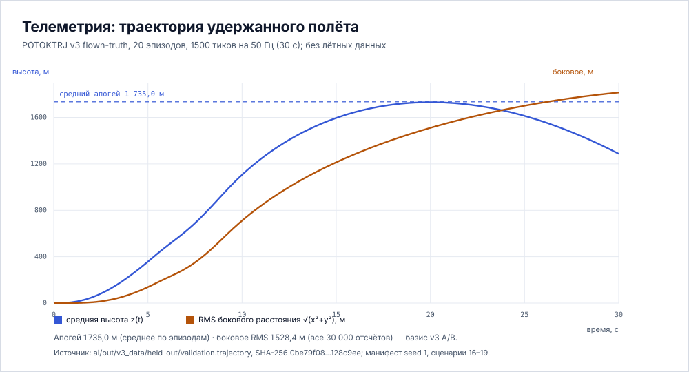

Телеметрия связывает симулятор, обучение и разбор полёта. Задача простая:
сырые байты сразу приводятся к таблице, шум фильтруется, пропуски и
выбросы помечаются, производные величины считаются автоматически, а набор
графиков собирается одной командой.

> Примечание: в текущей поставке реального лётного лога нет. Описанные
> процедуры и форматы проверены на синтетических и симуляционных данных.

## Что читается

- `validation.bin` v3 (`POTOKSIM`): 14 признаков и 6 целей на кадр —
  `g_roll`, `g_pitch`, confidence, `ai_healthy`, `g_accel_y`, `g_accel_x`.
  Авторитетная команда — `[g_accel_y, −g_accel_x]` м/с²; угловая пара —
  диагностика.
- `validation.trajectory` (`POTOKTRJ` v3, stride 26): истинные x/y/z и
  скорости на каждом тике; отсюда считаются апогей и боковое отклонение.
- Truth sidecar: полное состояние, ветер, порыв, сдвиговый слой и reference
  `g_theta`; доступен только привилегированному учителю, на борт не едет.

*Рисунок: POTOKTRJ v3, 20 удержанных эпизодов по 1500 тиков на 50 Гц.
Post-FIXPUMP базис нулевой команды: апогей 1972,9–1983,0 м и боковое RMS
1306,4–1309,4 м (`RECALC01.md`, `ab_report.md`). Старые 1734,98 / 1528,37 м —
исторический, отозванный контекст: до FIXPUMP аэродинамическая сила качала
энергию. Лётных логов нет.*

- `manifest.json`: схема, config hash, seed, split, сценарии, счётчики,
  имена и границы каналов, SHA-256 файлов.
- `quality-report.json`: NaN/Inf, границы, размеры, непересечение split,
  побитовая повторяемость генерации.

## Обработка

1. Сырой лог с флешки разбирается в таблицу по формату кадра; CRC и seq
   проверяются на приёме.
2. Шум фильтруется, пропуски и выбросы помечаются; подозрительные кадры
   удаляются до подачи в модель.
3. Считаются производные: высота, скорость, перегрузки, углы, фаза полёта.
4. Набор графиков строится одной командой и складывается в отчёт;
   страница полёта собирается автоматически из тех же таблиц.
5. Для обучения выгружается validation v3 с шестью целями; v1/v2 несут только
   диагностику и отвергаются loud.

## Границы truth

Физический baseline доступен студенту и борту. `g_theta` из оптимизатора —
привилегированная цель учителя, в A/B используется только как диагностика
tracking RMSE. Истинный ветер и порыв никогда не подаются в inputs студента.
Смену цели с угловой на ускорение нужно читать именно как смену единиц: v2- и
v3-числа несовместимы.

Код — [potok-m-ai](https://github.com/rocket-team-m/potok-m-ai), приём —
[potok-m-edge](https://github.com/rocket-team-m/potok-m-edge), формат кадра —
[potok-m-protocol](https://github.com/rocket-team-m/potok-m-protocol).
Собственный код — `GPL-3.0-or-later`, подробности — в
[лицензии](/potok-m/docs/project/licenses/).
