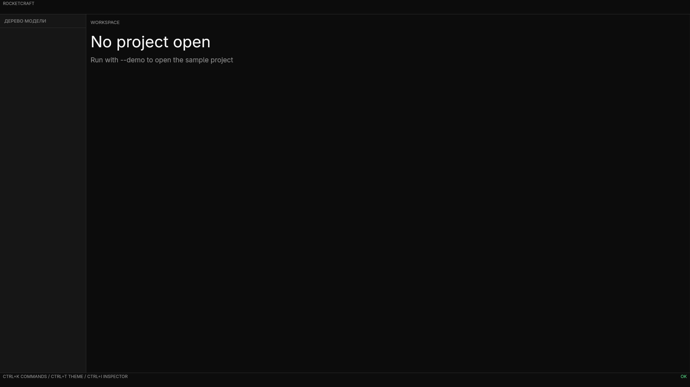
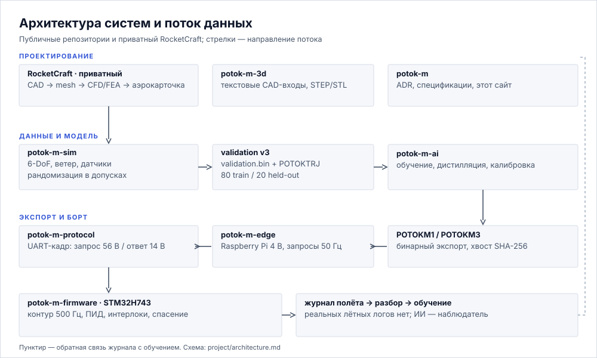

«Поток-М» — не один репозиторий, а набор канонических репозиториев с чёткими
границами. Здесь, в `potok-m`, живут документация, ADR и общие артефакты; код
изменяется только в том репозитории, который владеет соответствующей подсистемой.

## Публичные репозитории

| Репозиторий | Владеет |
| --- | --- |
| `.github` | профиль организации, описание карты репозиториев и визуальный стиль |
| `potok-m` | этот сайт, ADR, спецификации, общие отчёты |
| `potok-m-ai` | обучение моделей, LRS-TCN/RMS-TCN, LoopWM, экспорт и калибровка |
| `potok-m-sim` | 6-DoF симулятор, атмосфера, ветер, датчики, генерация validation v3 |
| `potok-m-protocol` | описание UART-кадра, генератор биндингов, C-эталон, `no_std`-библиотека |
| `potok-m-firmware` | прошивка STM32H743 на Rust/Embassy, SIL и бюджет тайминга |
| `potok-m-edge` | инференс на Raspberry Pi 4 B, калибровка и spekulativny dispatch |
| `potok-m-3d` | текстовые CAD-входы, обмен STEP/STL, спецификации геометрии |

Девятый репозиторий, `potok-m-workbench`, приватный: в нём разрабатывается
настольный инженерный воркбенч RocketCraft. Публичная документация ссылается на
него как на поставщика аэрокарточки, но не публикует его исходники.

*Скриншот: рабочее место RocketCraft в тёмной теме, 1920×1080; проект не открыт,
внизу — подсказки Ctrl+K / Ctrl+T / Ctrl+I.*

## Поток данных

*Рисунок: публичные репозитории и приватный RocketCraft; стрелки ведут от
аэрокарточки через симулятор и обучение к экспорту, борту и журналу. Пунктир —
обратная связь журнала с обучением.*

1. RocketCraft формирует аэрокарточку; это граница между CAD/CFD/FEA и
   динамикой. Симулятор потребляет карточку, а не исходные CAD-файлы.
2. `potok-m-sim` производит детерминированные эпизоды: `validation.bin` v3 с
   шестью целями и `validation.trajectory` (`POTOKTRJ`) сtruth-состоянием.
3. `potok-m-ai` обучает студента на 80 тренировочных эпизодах, оценивает на 20
   удержанных, экспортирует бинарную модель и калибровку.
4. `potok-m-edge` загружает экспорт, проверяет SHA-256, ведёт окно телеметрии и
   формирует две ограниченные поправки с confidence.
5. `potok-m-protocol` фиксирует байты запроса и ответа; `potok-m-firmware`
   читает ответ на STM32 на 500 Гц и применяет поправку только при открытом
   интерлоке и корректной фазе полёта.

## Границы ответственности

- **Документация и решения:** `potok-m`. ADR и спецификации здесь; код — там.
- **Физика и данные:** `potok-m-sim` и RocketCraft. Симулятор — источник
  обучающих сценариев, но не валидированный цифровой двойник.
- **Модель и её качество:** `potok-m-ai`. Метрики считаются на удержанных
  симуляционных сценариях; v3 closed-loop A/B в симуляции пройден, лётной квалификации нет.
- **Провода и безопасность:** `potok-m-protocol` задаёт формат,
  `potok-m-firmware` владеет интерлоками, `potok-m-edge` — инференсом.
- **Тяжёлые артефакты:** CAD-сборки, логи, ASNYS-результаты и модели уезжают в
  Releases; в git — только текст и файлы до 2 МБ.

Собственный код — `GPL-3.0-or-later`; подробности — в
[лицензии](/potok-m/docs/project/licenses/).
