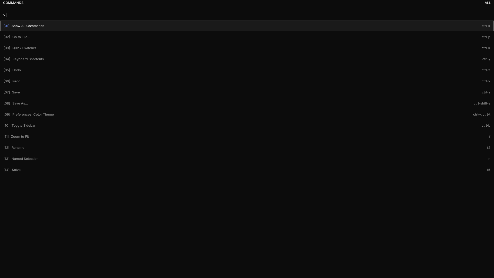

Все команды ниже выполняются в соответствующих канонических репозиториях;
карта — в [архитектуре](/potok-m/docs/project/architecture/).

## Сайт документации

```sh
cd docs
bun install
bun run dev      # http://localhost:4321/potok-m/
bun run build    # docs/dist, Pagefind и sitemap
```

Сборка автоматически запускается при пуше в `main`. Локальные ссылки
проверяются гейтом `link-check` из `.github/workflows/guard.yml`, лицензии —
гейтом `license-gate`, тяжёлые и бинарные файлы — `binary-size-guard`.

## ИИ

```sh
cd ai
uv sync
uv run ruff check src tests
uv run ruff format --check src tests
uv run pytest -q
```

Окружение — CPU-only `torch 2.15.0+cpu`; GPU в тестах не используется. Полный
прогон в отдельном репозитории `potok-m-ai` — 88 тестов; в канонической копии с
ночными hard-gate файлами число тестов больше и зависит от состава дерева.
Ночные gating-тесты фиксируют контракты экспорта, watchguard, дистилляции,
аугментации, conformal-калибровки и движка; они не заменяют A/B.
Текущий неослабленный closed-loop A/B — BRK04 (braking_v2, BRK03-fixed braking
teacher): `ai/.venv/bin/python scripts/ab_braking_v2.py` — exit 1 по замыслу,
verdict **FAIL**, 5 PASS / 6 FAIL (6 из 11 гейтов), `win_claimed = false`;
отчёты `scripts/ab_report_braking_v2.json` /
`scripts/ab_report_braking_v2.md` (`.bulba/night/BRK04.md`).
Deployment-латераль 1503,98 / 1539,51 / 1521,34 м > 1000 м, апогей 2294,88 /
2270,66 / 2277,60 м ≥ 2000 м, латераль −13,17 / −10,99 / −11,18 %, seed 3
апогея +14,86 % < +15 %, oracle-контроль не достоверен по апогею на seed 2/3.
История: v6 (`scripts/ab_v6.py`, night_final, exit 1, FAIL, default
4 PASS / 7 FAIL, adversarial 5 PASS / 6 FAIL), v5 (`scripts/ab_v5.py`, FINAL
all-fix, exit 1, FAIL, 5 PASS / 6 FAIL), v4 (`scripts/ab_v4.py`, AIPOST1, exit
1, FAIL, 4 PASS / 7 FAIL) и F1 (`scripts/ab_v3.py`, exit 0, PASS в узком
детекторе: латераль + знак привода, апогей — диагностика).

## Симулятор

```sh
cd sim
cargo test --workspace --offline
cargo fmt --all -- --check
cargo clippy --all-targets -- -D warnings
cargo test --workspace -p potok-or-parity
```

Канонический монорепозиторий содержит 154 теста workspace: 141 в `potok-sim`,
9 в CLI и 4 в `potok-or-parity`. Отдельный репозиторий `potok-m-sim` на своей
ветке проверен на 67 тестах; разница — в составе дерева, а не в качестве кода.
Если после перезапуска компоновщик падает с `Bus error` из-за обёртки
`sccache`, используйте чистый каталог:
`CARGO_TARGET_DIR=/tmp/potok-sim-target CARGO_BUILD_RUSTC_WRAPPER="" cargo test --workspace --offline`.

## Протокол

```sh
cd protocol
cargo test --workspace --offline
cargo fmt --all -- --check
cargo clippy --all-targets --offline -- -D warnings
cargo run --offline -p potok-generator -- --check
cargo check -p potok-protocol --no-default-features --offline
bash stm32/tests/check_golden.sh all
```

Проверка golden-байтов работает в трёх реализациях: C, Python и Rust. Ветка
`split-protocol` публикуется в отдельный репозиторий; `origin` в рабочем
дереве может указывать на монорепозиторий — перед push это нужно проверять.

## Прошивка

```sh
cd /home/sehaxe/potok-m-firmware
cargo fmt --all -- --check
cargo test --workspace
cargo clippy --workspace --all-targets -- -D warnings
cargo check --target thumbv7em-none-eabihf
cargo test --test safety --test watchguard_tests --test protocol_link_tests
cargo test --test perf_tests --test scheduler_tests --test watchdog_tests --test timing_budget_tests
```

Host-набор — 216 тестов в 22 integration-бинарниках. SIL-гейты: 25 тестов
инъекций отказов провода и 34 теста тайминга. Зелёный SIL — необходимое, но не
достаточное условие перед работой с платой.

## Edge

```sh
cd /home/sehaxe/potok-m-edge
cargo test --release --all-targets
cargo run --release --bin bench_v3 -- --frames 2000 --warmup 100 --check
```

Release-профиль обязателен: в debug-сборке интеграционный тест p99 даёт
примерно 11,2 мс при лимите 10 мс. В репозитории нет модельного бинарника —
он поставляется из `potok-m-ai` при разворачивании.

## RocketCraft

```sh
cd /home/sehaxe/potok-m-workbench
cargo run -p rocketcraft-ui --features app -- --demo
cargo test --workspace --all-targets
cargo clippy --workspace --all-targets -- -D warnings
bash scripts/check_license.sh
bash scripts/check_visual.sh --self-test
```

Демо открывает фиксированный проект `Sample Rocket` без выбора файла.


*Скриншот: `Sample Rocket`, светлая тема, 1920×1080; 4 детали, предпросмотр без
физики, Mesh/Aero/FEA — NOT RUN.*



*Скриншот: палитра по Ctrl+K, тёмная тема, 1920×1080; 14 команд с индексами
[01]…[14]. Это снимки интерфейса, не baseline визуальной матрицы.*

`scripts/check_visual.sh` в полном режиме красный по замыслу: 12 скриншотов
матрицы не коммитятся, а точка съёмки отсутствует.

## Ограничения, которые нельзя забывать

:::danger
Нет ни одного записанного полёта, плата не вводилась в строй, симулятор не
является цифровым двойником, а ИИ не допущен к управлению. Ни один из гейтов
ниже не является лётной квалификацией.
:::

- Симулятор пригоден для отладки архитектуры и регрессионных тестов; сверка
  с OpenRocket — регрессионные пины с порогами, выбранными после измерения.
- Closed-loop A/B: **текущий BRK04 (braking_v2, BRK03-fixed braking teacher) —
  FAIL** (`scripts/ab_report_braking_v2.json`, exit 1, `win_claimed = false`,
  5 PASS / 6 FAIL, 6 из 11 гейтов). Неослабленные гейты v6/EVAL01, вызываемые
  дословно из `scripts/ab_v6.py`: deployment-латераль 1503,98 / 1539,51 /
  1521,34 м > 1000 м на всех сидах; апогей 2294,88 / 2270,66 / 2277,60 м ≥
  2000 м; приросты латерали −13,17 / −10,99 / −11,18 %, апогея +16,27 /
  +15,09 / +14,86 % не дают −35 % / +15 % (seed 3 апогея < +15 %);
  oracle-контроль не проходит (апогей +11,69 / −2,15 / −7,60 м, латераль
  −40,48 / −37,79 / −35,99 м, cap fraction 1,0 — привод насыщен ±10 м/с² на
  каждом активном тике). Held-out RMSE 8,391135 ± 1,292430 м/с²;
  BRK03-исправление цели подтверждено 964 активными строками на seed (против
  0 в BRK02). Гейты не ослаблены, победы не заявлено. **История:** v6
  (night_final, обе руки, FAIL, exit 1, default 4 PASS / 7 FAIL,
  adversarial 5 PASS / 6 FAIL; деплой-латераль 1462,98 / 1560,57 / 1454,26 м
  и 1458,08 / 1553,58 / 1456,54 м > 1000 м, апогей 2366,25 / 2213,94 /
  2327,48 м и 2347,99 / 2252,12 / 2308,26 м ≥ 2000 м, приросты латерали
  −14,58 / −9,48 / −13,55 % и −13,52 / −9,71 / −12,52 %, апогея +19,89 /
  +12,22 / +17,37 % и +18,96 / +14,16 / +16,40 %; `seed_spread` проходит
  только у adversarial), v5 (FINAL all-fix, FAIL, exit 1, 5 PASS / 6 FAIL;
  деплой-латераль 1473,06 / 1558,44 / 1496,79 м > 1000 м, апогей ≥2000 м на
  всех сидах), v4 (AIPOST1, FAIL, exit 1,
  4 PASS / 7 FAIL; латераль 1611,99 / 1632,11 / 1642,11 м, апогей <2000 м на
  seed 2/3) и F1 (ABFIX/ORCLR, exit 0) — PASS только по латерали+знаку (oracle
  −17,312 / −10,503 / −8,382 м, 12/12 знаков, привод на пределе, апогей —
  диагностика; `loopwm`/`lite` CREDITED 3/3, `lrs` PARTIAL 2/3). Нулевая
  команда v3: латераль 1306–1309 м, апогей 1973–1983 м; пре-FIXPUMP +2 км
  (3971 м), бары 1528/1735 м и прежний PASS отозваны. Это не лётная
  квалификация: модель работает в режиме наблюдателя/советчика.
- В прошивке `hw::build_board()`, пины, DMA, фазовые события и привод — заглушки
  до подтверждения схемы и BOM; SIL их не заменяет.
- Edge-инференс: p99 на Raspberry Pi не измерен, NEON проверен только
  компиляцией; v3-таблица экспорта определена ридером, production writer и
  ветка `Runtime::load` для `POTOKM3\0` отсутствуют.
- В RocketCraft возможности C12–C21 и C23–C24 запланированы, C14 и C16 —
  исследовательские; визуальная матрица 0 из 12.

Собственный код — `GPL-3.0-or-later`, подробности — в
[лицензии](/potok-m/docs/project/licenses/).
