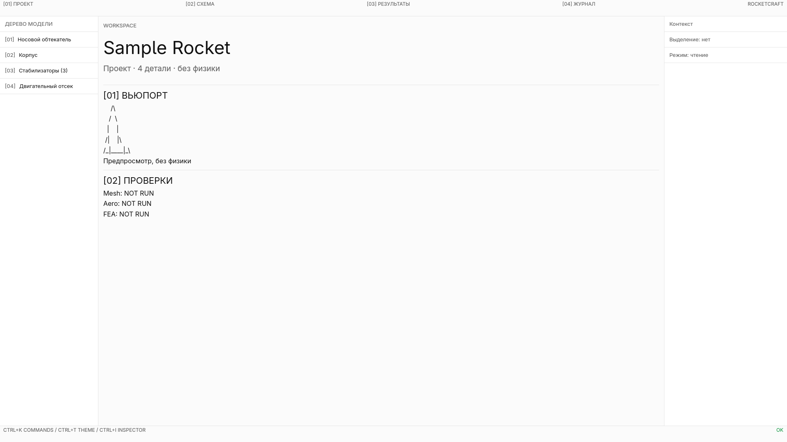

Все команды ниже выполняются в соответствующих канонических репозиториях;
карта — в [архитектуре](/potok-m/docs/project/architecture/).

## Сайт документации

```sh
cd docs
bun install
bun run dev      # http://localhost:4321/potok-m/
bun run build    # docs/dist, Pagefind и sitemap
```

Сборка автоматически запускается при пуше в `main`. Локальные ссылки
проверяются гейтом `link-check` из `.github/workflows/guard.yml`, лицензии —
гейтом `license-gate`, тяжёлые и бинарные файлы — `binary-size-guard`.

## ИИ

```sh
cd ai
uv sync
uv run ruff check src tests
uv run ruff format --check src tests
uv run pytest -q
```

Окружение — CPU-only `torch 2.15.0+cpu`; GPU в тестах не используется. Полный
прогон в отдельном репозитории `potok-m-ai` — 88 тестов; в канонической копии с
ночными hard-gate файлами число тестов больше и зависит от состава дерева.
Ночные gating-тесты фиксируют контракты экспорта, watchguard, дистилляции,
аугментации, conformal-калибровки и движка; они не заменяют A/B.

## Симулятор

```sh
cd sim
cargo test --workspace --offline
cargo fmt --all -- --check
cargo clippy --all-targets -- -D warnings
cargo test --workspace -p potok-or-parity
```

Канонический монорепозиторий содержит 154 теста workspace: 141 в `potok-sim`,
9 в CLI и 4 в `potok-or-parity`. Отдельный репозиторий `potok-m-sim` на своей
ветке проверен на 67 тестах; разница — в составе дерева, а не в качестве кода.
Если после перезапуска компоновщик падает с `Bus error` из-за обёртки
`sccache`, используйте чистый каталог:
`CARGO_TARGET_DIR=/tmp/potok-sim-target CARGO_BUILD_RUSTC_WRAPPER="" cargo test --workspace --offline`.

## Протокол

```sh
cd protocol
cargo test --workspace --offline
cargo fmt --all -- --check
cargo clippy --all-targets --offline -- -D warnings
cargo run --offline -p potok-generator -- --check
cargo check -p potok-protocol --no-default-features --offline
bash stm32/tests/check_golden.sh all
```

Проверка golden-байтов работает в трёх реализациях: C, Python и Rust. Ветка
`split-protocol` публикуется в отдельный репозиторий; `origin` в рабочем
дереве может указывать на монорепозиторий — перед push это нужно проверять.

## Прошивка

```sh
cd /home/sehaxe/potok-m-firmware
cargo fmt --all -- --check
cargo test --workspace
cargo clippy --workspace --all-targets -- -D warnings
cargo check --target thumbv7em-none-eabihf
cargo test --test safety --test watchguard_tests --test protocol_link_tests
cargo test --test perf_tests --test scheduler_tests --test watchdog_tests --test timing_budget_tests
```

Host-набор — 216 тестов в 22 integration-бинарниках. SIL-гейты: 25 тестов
инъекций отказов провода и 34 теста тайминга. Зелёный SIL — необходимое, но не
достаточное условие перед работой с платой.

## Edge

```sh
cd /home/sehaxe/potok-m-edge
cargo test --release --all-targets
cargo run --release --bin bench_v3 -- --frames 2000 --warmup 100 --check
```

Release-профиль обязателен: в debug-сборке интеграционный тест p99 даёт
примерно 11,2 мс при лимите 10 мс. В репозитории нет модельного бинарника —
он поставляется из `potok-m-ai` при разворачивании.

## RocketCraft

```sh
cd /home/sehaxe/potok-m-workbench
cargo run -p rocketcraft-ui --features app -- --demo
cargo test --workspace --all-targets
cargo clippy --workspace --all-targets -- -D warnings
bash scripts/check_license.sh
bash scripts/check_visual.sh --self-test
```

Демо открывает фиксированный проект `Sample Rocket` без выбора файла.



*Скриншот: `Sample Rocket`, светлая тема, 1920×1080; 4 детали, предпросмотр без
физики, Mesh/Aero/FEA — NOT RUN.*


*Скриншот: палитра по Ctrl+K, тёмная тема, 1920×1080; 14 команд с индексами
[01]…[14]. Это снимки интерфейса, не baseline визуальной матрицы.*

`scripts/check_visual.sh` в полном режиме красный по замыслу: 12 скриншотов
матрицы не коммитятся, а точка съёмки отсутствует.

## Ограничения, которые нельзя забывать

:::danger
Нет ни одного записанного полёта, плата не вводилась в строй, симулятор не
является цифровым двойником, а ИИ не допущен к управлению. Ни один из гейтов
ниже не является лётной квалификацией.
:::

- Симулятор пригоден для отладки архитектуры и регрессионных тестов; сверка
  с OpenRocket — регрессионные пины с порогами, выбранными после измерения.
- V3 closed-loop A/B на текущей физике **провален** (post-FIXPUMP, verdict FAIL):
  oracle-положительный контроль не проходит на сидах 2/3 (апогей 1972,859 →
  1970,708 м и 1983,003 → 1975,402 м), поэтому студентские результаты не
  засчитаны. Нулевая команда даёт боковое RMS 1306–1309 м и апогей 1973–1983 м;
  `loopwm` на seed 1: 1309,409 → 1267,367 м (−42,04 м), апогей +104,04 м —
  зафиксировано, но не засчитано. `lrs` seed 3 не измерен из-за отсутствующего
  экспорта. Прежние −26 м / +125 м и вердикт PASS отозваны. Это не лётная
  квалификация: модель работает в режиме наблюдателя/советчика.
- В прошивке `hw::build_board()`, пины, DMA, фазовые события и привод — заглушки
  до подтверждения схемы и BOM; SIL их не заменяет.
- Edge-инференс: p99 на Raspberry Pi не измерен, NEON проверен только
  компиляцией; v3-таблица экспорта определена ридером, production writer и
  ветка `Runtime::load` для `POTOKM3\0` отсутствуют.
- В RocketCraft возможности C12–C21 и C23–C24 запланированы, C14 и C16 —
  исследовательские; визуальная матрица 0 из 12.

Собственный код — `GPL-3.0-or-later`, подробности — в
[лицензии](/potok-m/docs/project/licenses/).
